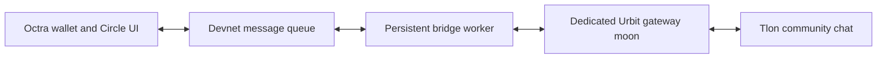

# Octra × Urbit Social Bridge

A public devnet chat connecting an Octra Circle with a Tlon community on Urbit.

**Visiting from Octra?** Start with the [Circle user guide](docs/OCTRA-USER-GUIDE.md): install the wallet, switch to devnet, get test OCT, and send your first message.

**Visiting from Urbit?** [Join Octra Social Bridge](https://invite.tlon.io/~tiptux-ponryg/octra-welcome) and open **Bridge chat**. Group code: `~tiptux-ponryg/octra-welcome`.

Open this address in the Octra wallet's Circles browser with devnet selected:

```text
oct://oct3K5KsomirPMaPrGZC2dRv7ZvirdAm6WV7DybuH3gePYe/index.html
```

Reading is free. Sending from Octra currently costs **0.001 devnet OCT** per message; the operator pays to mirror Urbit messages into the Circle. See [costs](docs/COSTS.md) and the gated [devnet faucet bot](https://t.me/octradevbot). Messages and wallet addresses are public. Delivery depends on devnet confirmation; use the room's status check instead of resending while waiting.

## How it works



The Circle uses native wallet calls and views. Committed transaction callers determine guest identity. One gateway moon carries all guest posts into Tlon, labeled with the guest nickname and a short wallet-derived identifier. Native Urbit replies return to the Circle with their ship names. Visitors receive no ship login or Dojo access.

SQLite tracks delivery and threading. A persistent transaction outbox records signing intent before submission; uncertain submissions are reconciled rather than blindly repeated. Tlon reaction counts, changes, and removals are checked only after a new chat message arrives, then published as one changed snapshot.

## Try the local simulation

Requires **Node.js 22.13 or newer**. The application and unit tests use Node's standard library; there are no production npm dependencies.

```sh
npm test
npm start
```

Open `http://127.0.0.1:8787`. Alice and Bob are simulated guests, and Urbit replies are simulated too. This mode uses no wallets, live ship credentials, RPC, or transaction fees. It binds to loopback and is not a public relay deployment.

## Build the Circle page

```sh
npm run build
```

This creates `build/index.html` without credentials or network access. A new room shows history from record zero. For an intentional display cutoff, set `BRIDGE_VISIBLE_AFTER` when building; this hides old records in the UI and does not erase chain data.

## Run a bridge of your own

See [operator setup](docs/OPERATOR-GUIDE.md). You need your own dedicated moon, Tlon group/channel, devnet operator wallet, and Circle. Configuration starts from `config/target.example.json`, with posting disabled. Provisioning a ship and exposing it safely are separate operator tasks.

Source layout:

- `program/`: AppliedML queue, permissions, deduplication, and reaction storage.
- `web/` and `shared/`: Circle UI, native wallet transport, decoding, and local fixture UI.
- `src/`: gateway, Tlon/Eyre integration, durable store, signing, and local simulation.
- `scripts/`: operator preparation, program compilation, Circle publication, and worker.
- `test/`: unit/integration tests and synthetic browser checks.
- `docs/`: visitor instructions, fee estimates, and operator setup.

The earlier optional relay prototype remains in the source and tests. Its default client-reported identity is **not proof of wallet ownership**; the deployed Circle uses committed transaction identity instead.

## Browser checks

Browser tests are optional and require Playwright and Chromium:

```sh
npm install --no-save --package-lock=false playwright
npx playwright install chromium
npm run build
npm run test:browser
npm run test:feedback
npm run test:progress
```

Set `ALPHA_PLAYWRIGHT` to an absolute module path or `ALPHA_CHROMIUM` to a browser executable to use existing installations. These tests use synthetic wallet responses and a local fixture; they do not send live transactions.

## Alpha limits

This is experimental, unaudited software. Messages are public devnet records. The queue allows three new sends per wallet per epoch, 2,000 UTF-8 bytes per message, 24 bytes per guest nickname, and 10,000 total records. Epochs are not fixed seconds.

Posts and one-level threads are supported. Attachments, synchronized edits/deletions, and Circle-to-Tlon reaction buttons are not implemented. The Circle displays the latest 50 records. Its pending receipt stays in memory because the wallet runs it in an opaque sandbox. Identical text/nickname/thread is treated as a retry within the same history boundary.

The live alpha has previously passed two-way message, threading, and restart tests; this release's automated checks do not establish current devnet availability or every wallet's compatibility. Keep the database and operator outbox across restarts. Do not run two copies of a live pier or gateway.

## License and release scope

MIT licensed; see [LICENSE](LICENSE). This release includes the bridge application, queue program, build/publication tools, tests, and guides. It excludes live credentials, keys, balances, transaction receipts, chat databases, machine provisioning, personal infrastructure configuration, and local Git history. Third-party community artwork and the separate proposed webcli patch are not bundled.

Protocol references: [Octra documentation](https://docs.octra.org/), [Octra webcli](https://github.com/octra-labs/webcli), and [Tlon apps](https://github.com/tloncorp/tlon-apps). Those projects retain their own licenses.
